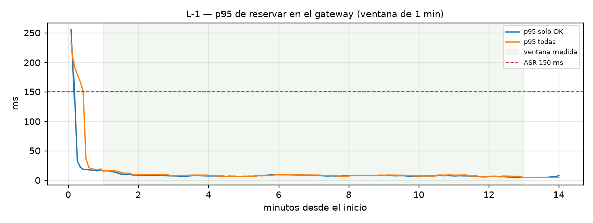
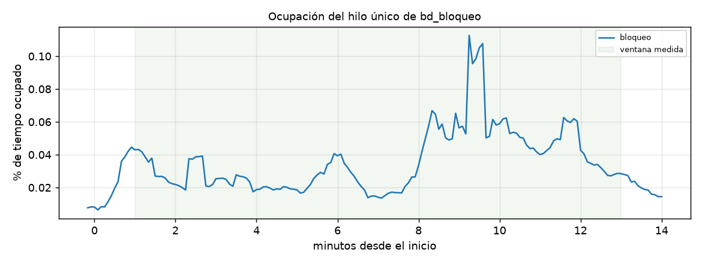
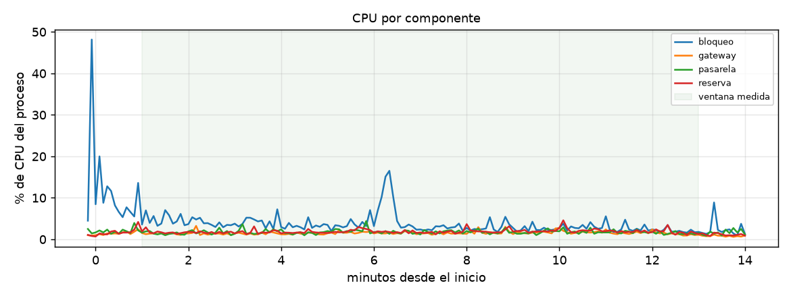
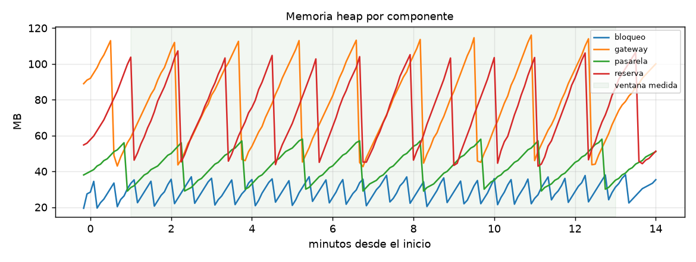
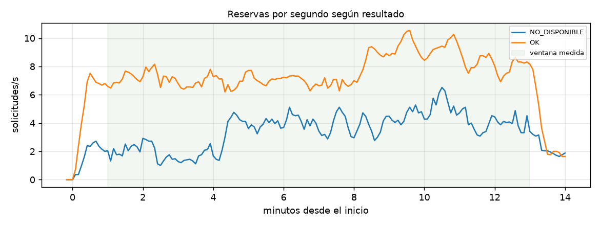
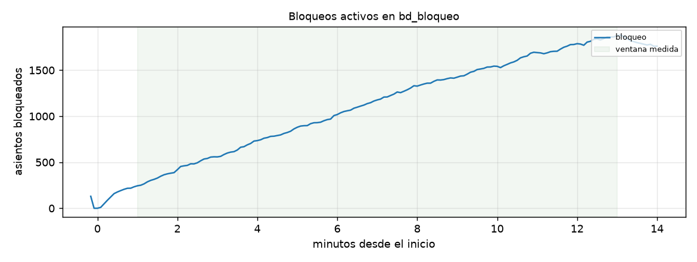

# Métricas L-1 — corrida-1

**Corrida VÁLIDA ✅** — atraso del generador frente al calendario: p95 = 3 ms, máx. = 76 ms; diferencia de solicitudes gateway vs. cliente = 0.21 %; desfase de reloj de Prometheus = 0.00 s.

**Veredicto L-1: CUMPLE ✅** — p95 de reservar en el gateway = **7.8 ms** (ASR ≤ 150 ms), ventana de 720 s de tráfico normal (se excluye el minuto de calentamiento).

## Latencia de reservar

| Medición | Frontera | n | p50 (ms) | p95 (ms) | p99 (ms) | % ≤ 150 ms |
|---|---|---|---|---|---|---|
| **ASR — solo reservas exitosas** | gateway (Prometheus) | 5591 | 2.7 | **7.8** | 15.8 | 100.00 % |
| Todas las respuestas (éxito + rechazo) | gateway (Prometheus) | 8180 | 2.8 | 8.3 | 17.1 | 100.00 % |
| Solo exitosas | cliente (JMeter/bitácora) | 5590 | 5.0 | 12.0 | 21.0 | 99.98 % |
| Todas | cliente (JMeter/bitácora) | 8164 | 5.0 | 13.0 | 22.0 | 99.99 % |

- Diferencia del p95 (cliente − gateway, solo exitosas): **4.2 ms** (red local de kind + kube-proxy + cliente HTTP).
- El p95 del gateway se calcula con histogramas de Prometheus (cubetas en 100, 125, 150, 200 ms…), por lo que se interpola dentro de la cubeta; el porcentaje ≤ 150 ms es exacto porque 150 ms es un borde de cubeta.
- Tasa real medida en el gateway: 682 solicitudes de reservar por minuto (400 llegadas normales por minuto + las solicitudes de los conflictos).
- Resultados en la ventana: NO_DISPONIBLE = 2588, OK = 5591. Rechazos por cola llena: 0.

## Recursos y colas (ventana medida)

| Componente | CPU prom. (%) | CPU máx. (%) | Heap prom. (MB) | Heap máx. (MB) |
|---|---|---|---|---|
| bloqueo | 3.6 | 16.5 | 29.0 | 38.0 |
| gateway | 1.5 | 3.2 | 77.7 | 116.1 |
| pasarela | 1.8 | 4.4 | 43.0 | 58.0 |
| reserva | 1.9 | 4.6 | 73.3 | 107.3 |

| Indicador | Promedio | Máximo |
|---|---|---|
| Profundidad de `cola_solicitud` | 0.0 | 0.0 |
| Profundidad de `cola_operacion` (hilo único) | 0.0 | 0.0 |
| Profundidad de `cola_persistencia` | 0.0 | 0.0 |
| Ocupación del hilo único de `bd_bloqueo` (%) | 0.0 | 0.1 |
| Operaciones por segundo en `bd_bloqueo` | 16.0 | 20.9 |
| Bloqueos activos | 1,138.9 | 1,877.0 |

- Caché de asientos: 5806 aciertos y 4 fallos (tasa de acierto 99.9 %).
- Operaciones en `bd_bloqueo` durante la ventana: bloquear = 8176, vender = 3415.
- CPU: porcentaje del proceso JVM (`process_cpu_usage`), no de la máquina.

