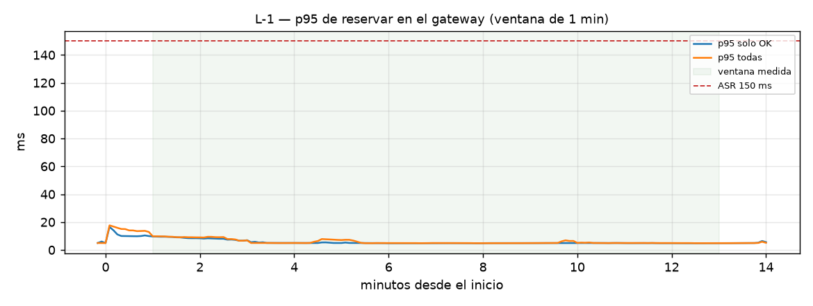
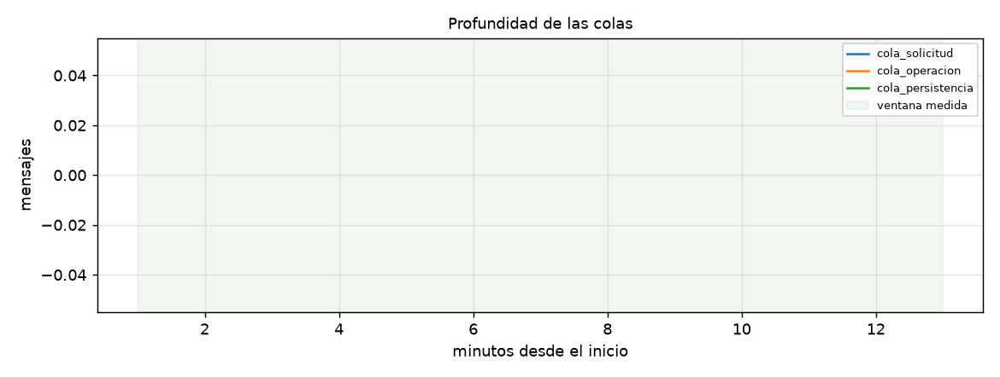
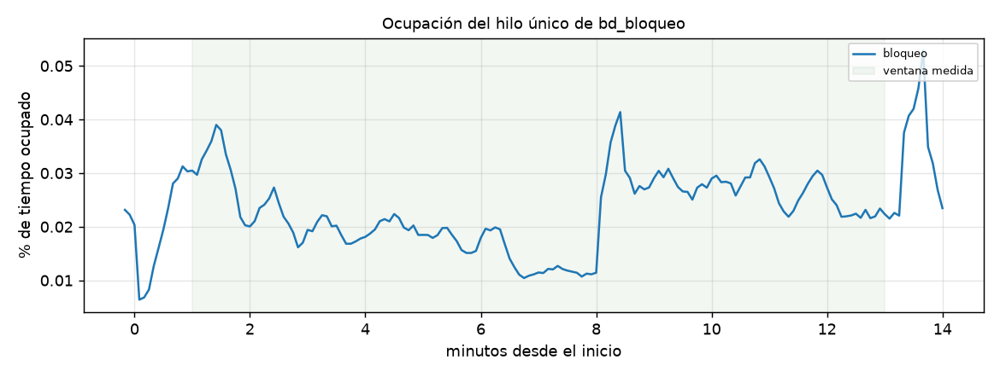
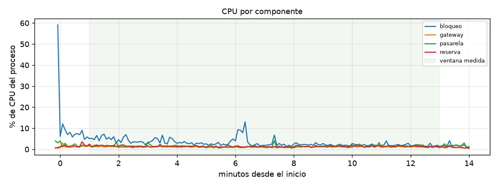
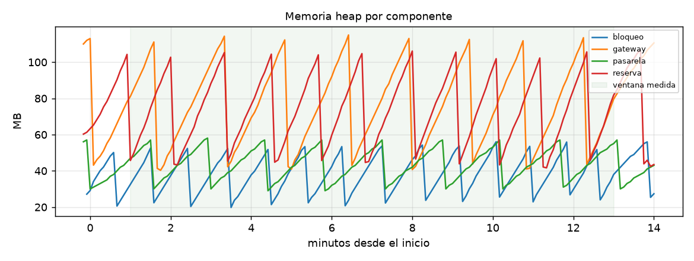
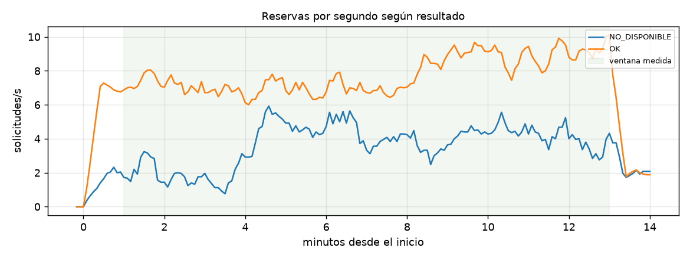
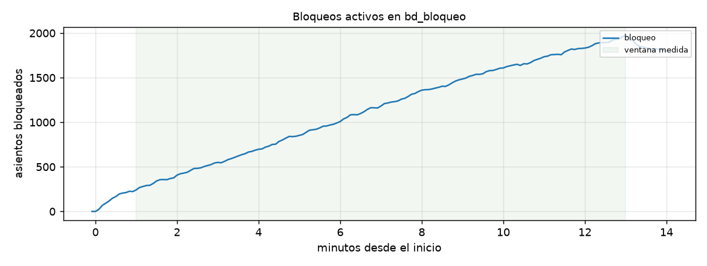

# Métricas L-1 — corrida-2

**Corrida VÁLIDA ✅** — atraso del generador frente al calendario: p95 = 2 ms, máx. = 43 ms; diferencia de solicitudes gateway vs. cliente = 0.19 %; desfase de reloj de Prometheus = 0.00 s.

**Veredicto L-1: CUMPLE ✅** — p95 de reservar en el gateway = **4.9 ms** (ASR ≤ 150 ms), ventana de 720 s de tráfico normal (se excluye el minuto de calentamiento).

## Latencia de reservar

| Medición | Frontera | n | p50 (ms) | p95 (ms) | p99 (ms) | % ≤ 150 ms |
|---|---|---|---|---|---|---|
| **ASR — solo reservas exitosas** | gateway (Prometheus) | 5630 | 2.6 | **4.9** | 9.4 | 100.00 % |
| Todas las respuestas (éxito + rechazo) | gateway (Prometheus) | 8296 | 2.6 | 5.0 | 9.9 | 100.00 % |
| Solo exitosas | cliente (JMeter/bitácora) | 5625 | 3.0 | 8.0 | 14.0 | 100.00 % |
| Todas | cliente (JMeter/bitácora) | 8281 | 4.0 | 9.0 | 16.0 | 100.00 % |

- Diferencia del p95 (cliente − gateway, solo exitosas): **3.1 ms** (red local de kind + kube-proxy + cliente HTTP).
- El p95 del gateway se calcula con histogramas de Prometheus (cubetas en 100, 125, 150, 200 ms…), por lo que se interpola dentro de la cubeta; el porcentaje ≤ 150 ms es exacto porque 150 ms es un borde de cubeta.
- Tasa real medida en el gateway: 691 solicitudes de reservar por minuto (400 llegadas normales por minuto + las solicitudes de los conflictos).
- Resultados en la ventana: NO_DISPONIBLE = 2666, OK = 5630. Rechazos por cola llena: 0.

## Recursos y colas (ventana medida)

| Componente | CPU prom. (%) | CPU máx. (%) | Heap prom. (MB) | Heap máx. (MB) |
|---|---|---|---|---|
| bloqueo | 3.1 | 13.1 | 38.0 | 56.1 |
| gateway | 1.1 | 2.1 | 76.2 | 115.0 |
| pasarela | 1.4 | 4.1 | 43.9 | 58.1 |
| reserva | 1.4 | 2.5 | 73.0 | 106.1 |

| Indicador | Promedio | Máximo |
|---|---|---|
| Profundidad de `cola_solicitud` | 0.0 | 0.0 |
| Profundidad de `cola_operacion` (hilo único) | 0.0 | 0.0 |
| Profundidad de `cola_persistencia` | 0.0 | 0.0 |
| Ocupación del hilo único de `bd_bloqueo` (%) | 0.0 | 0.0 |
| Operaciones por segundo en `bd_bloqueo` | 16.1 | 19.9 |
| Bloqueos activos | 1,146.3 | 1,959.0 |

- Caché de asientos: 5846 aciertos y 4 fallos (tasa de acierto 99.9 %).
- Operaciones en `bd_bloqueo` durante la ventana: bloquear = 8292, vender = 3387.
- CPU: porcentaje del proceso JVM (`process_cpu_usage`), no de la máquina.

