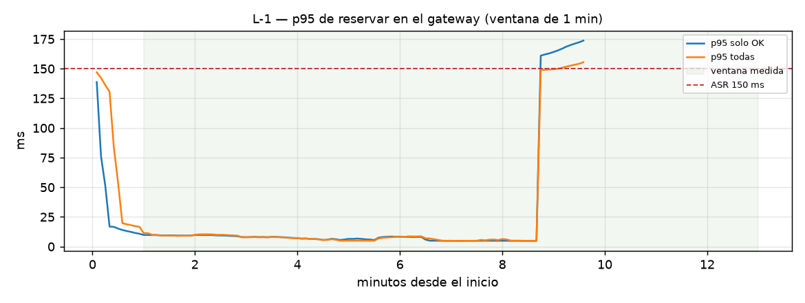
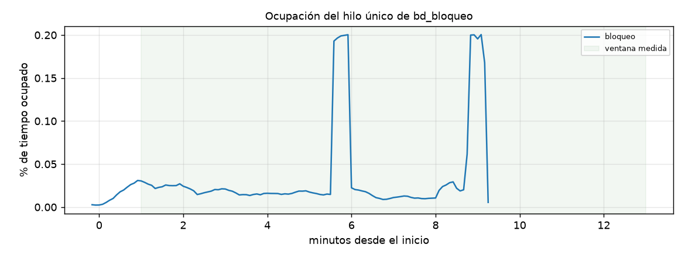
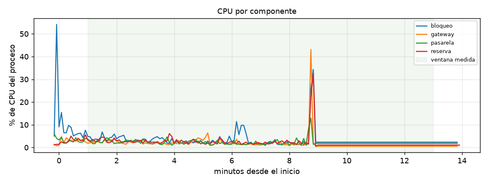
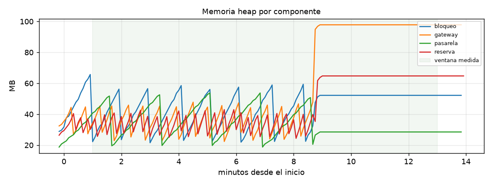
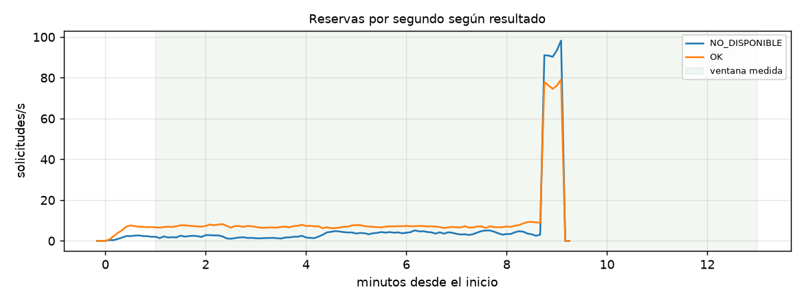
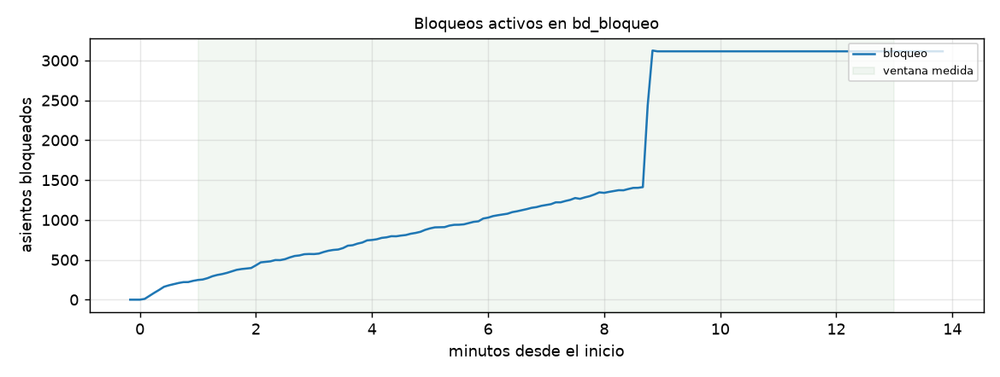

# Métricas L-1 — corrida-1

**Veredicto L-1: CUMPLE ✅** — p95 de reservar en el gateway = **132.1 ms** (ASR ≤ 150 ms), ventana de 720 s de tráfico normal (se excluye el minuto de calentamiento).

## Latencia de reservar

| Medición | Frontera | n | p50 (ms) | p95 (ms) | p99 (ms) | % ≤ 150 ms |
|---|---|---|---|---|---|---|
| **ASR — solo reservas exitosas** | gateway (Prometheus) | 5107 | 4.2 | **132.1** | 197.2 | 97.47 % |
| Todas las respuestas (éxito + rechazo) | gateway (Prometheus) | 8785 | 5.6 | 132.1 | 190.9 | 97.50 % |
| Solo exitosas | cliente (JMeter/bitácora) | 3286 | 4.0 | 10.0 | 15.0 | 100.00 % |
| Todas | cliente (JMeter/bitácora) | 4715 | 4.0 | 11.0 | 17.0 | 100.00 % |

- Diferencia del p95 (cliente − gateway, solo exitosas): **-122.1 ms** (red local de kind + kube-proxy + cliente HTTP).
- El p95 del gateway se calcula con histogramas de Prometheus (cubetas en 100, 125, 150, 200 ms…), por lo que se interpola dentro de la cubeta; el porcentaje ≤ 150 ms es exacto porque 150 ms es un borde de cubeta.
- Tasa real medida en el gateway: 732 solicitudes de reservar por minuto (400 llegadas normales por minuto + las solicitudes de los conflictos).
- Resultados en la ventana: NO_DISPONIBLE = 3678, OK = 5107. Rechazos por cola llena: 0.

## Recursos y colas (ventana medida)

| Componente | CPU prom. (%) | CPU máx. (%) | Heap prom. (MB) | Heap máx. (MB) |
|---|---|---|---|---|
| bloqueo | 3.2 | 34.3 | 44.1 | 59.3 |
| gateway | 1.8 | 43.1 | 57.6 | 97.8 |
| pasarela | 2.2 | 12.9 | 33.8 | 53.7 |
| reserva | 2.3 | 32.4 | 44.5 | 64.8 |

| Indicador | Promedio | Máximo |
|---|---|---|
| Profundidad de `cola_solicitud` | 0.0 | 0.0 |
| Profundidad de `cola_operacion` (hilo único) | 0.0 | 0.0 |
| Profundidad de `cola_persistencia` | 3.6 | 520.0 |
| Ocupación del hilo único de `bd_bloqueo` (%) | 0.0 | 0.2 |
| Operaciones por segundo en `bd_bloqueo` | 22.7 | 175.6 |
| Bloqueos activos | 1,661.2 | 3,125.0 |

- Caché de asientos: 4271 aciertos y 1055 fallos (tasa de acierto 80.2 %).
- Operaciones en `bd_bloqueo` durante la ventana: bloquear = 8769, vender = 2309.
- CPU: porcentaje del proceso JVM (`process_cpu_usage`), no de la máquina.

