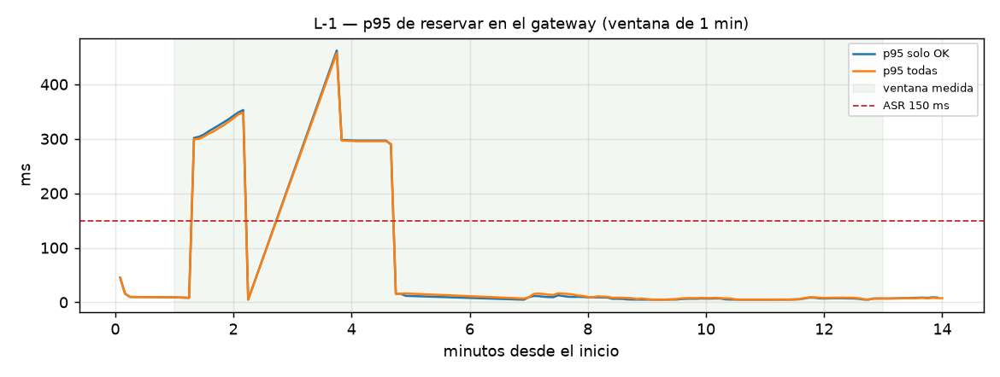
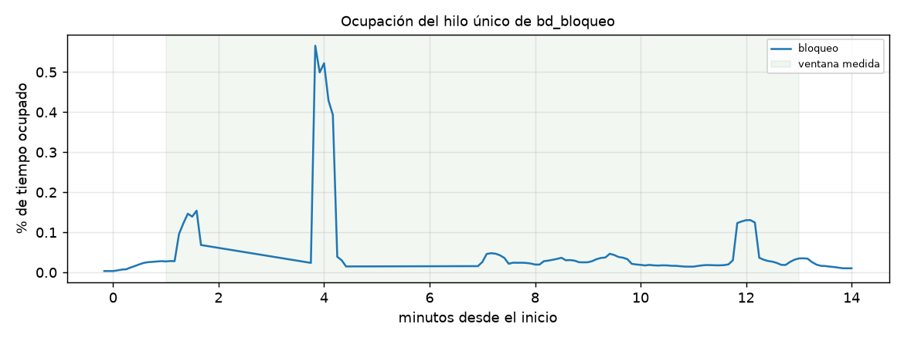
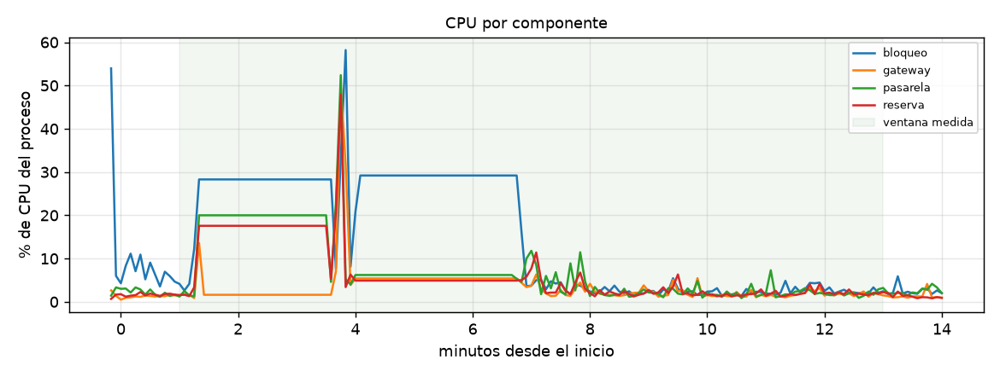
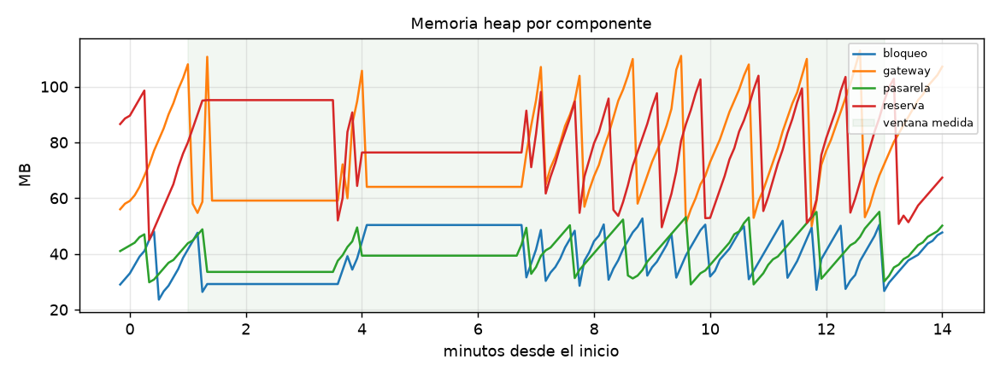
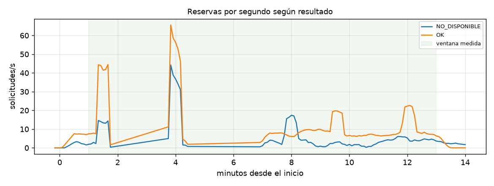
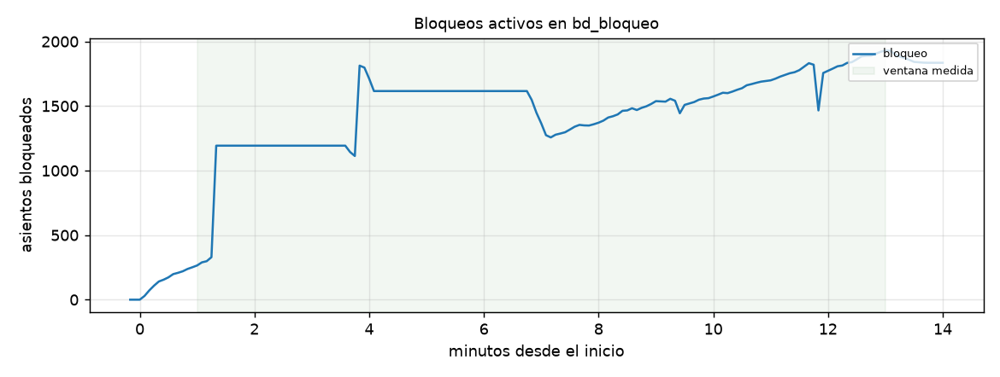

# Métricas L-1 — corrida-3

**Veredicto L-1: NO CUMPLE ❌** — p95 de reservar en el gateway = **270.9 ms** (ASR ≤ 150 ms), ventana de 720 s de tráfico normal (se excluye el minuto de calentamiento).

## Latencia de reservar

| Medición | Frontera | n | p50 (ms) | p95 (ms) | p99 (ms) | % ≤ 150 ms |
|---|---|---|---|---|---|---|
| **ASR — solo reservas exitosas** | gateway (Prometheus) | 5945 | 4.2 | **270.9** | 402.4 | 73.93 % |
| Todas las respuestas (éxito + rechazo) | gateway (Prometheus) | 8643 | 4.4 | 273.7 | 394.9 | 72.58 % |
| Solo exitosas | cliente (JMeter/bitácora) | 5941 | 5.0 | 287.0 | 651.8 | 72.58 % |
| Todas | cliente (JMeter/bitácora) | 8640 | 6.0 | 287.0 | 654.2 | 71.31 % |

- Diferencia del p95 (cliente − gateway, solo exitosas): **16.1 ms** (red local de kind + kube-proxy + cliente HTTP).
- El p95 del gateway se calcula con histogramas de Prometheus (cubetas en 100, 125, 150, 200 ms…), por lo que se interpola dentro de la cubeta; el porcentaje ≤ 150 ms es exacto porque 150 ms es un borde de cubeta.
- Tasa real medida en el gateway: 720 solicitudes de reservar por minuto (400 llegadas normales por minuto + las solicitudes de los conflictos).
- Resultados en la ventana: NO_DISPONIBLE = 2698, OK = 5945. Rechazos por cola llena: 0.

## Recursos y colas (ventana medida)

| Componente | CPU prom. (%) | CPU máx. (%) | Heap prom. (MB) | Heap máx. (MB) |
|---|---|---|---|---|
| bloqueo | 14.6 | 58.2 | 40.4 | 52.7 |
| gateway | 3.4 | 50.0 | 73.2 | 112.9 |
| pasarela | 7.3 | 52.4 | 39.9 | 55.1 |
| reserva | 6.4 | 47.9 | 80.3 | 103.9 |

| Indicador | Promedio | Máximo |
|---|---|---|
| Profundidad de `cola_solicitud` | 0.1 | 20.0 |
| Profundidad de `cola_operacion` (hilo único) | 0.0 | 0.0 |
| Profundidad de `cola_persistencia` | 0.2 | 24.0 |
| Ocupación del hilo único de `bd_bloqueo` (%) | 0.1 | 0.6 |
| Operaciones por segundo en `bd_bloqueo` | 28.0 | 151.1 |
| Bloqueos activos | 1,480.9 | 1,930.0 |

- Caché de asientos: 5181 aciertos y 969 fallos (tasa de acierto 84.2 %).
- Operaciones en `bd_bloqueo` durante la ventana: bloquear = 8666, vender = 3403.
- CPU: porcentaje del proceso JVM (`process_cpu_usage`), no de la máquina.

